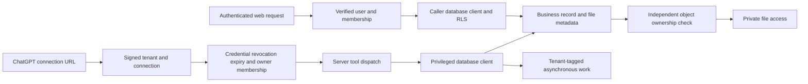

# Volteira Multi-Tenant Readiness Report

Date: 2026-11-17 UTC. Decision: **NOT READY**.

**Update after reconnection:** Supabase access now works. Read the [live database addendum](LIVE-DATABASE-ADDENDUM.md), which supersedes the initial connector-blocker statements below. Live schema gaps corroborate the relationship and storage findings. Authenticated end-to-end testing remains incomplete.

This is an interim implementation and verification report, not a completed certification. Do not onboard another paying business on the strength of this audit. High-severity boundaries remain unverified in the deployed system, and the remediation has not been deployed. No production data, schema, RLS, credentials, deployment, or external messages were changed.

## 1. Executive summary and scope

The verified repository is `Sugar-Kane/Electrician-App`, checked out at `b0da8e51bc584ed371fd3bd7f2041cab2c63f5c3`. Vercel's production deployment metadata identifies this same repository and commit for `volteira.com` and `www.volteira.com`, project `electrician-app`. Vercel's deployment status READY describes a deployment build, not security readiness.

Supabase discovery returned `This app tool requires a non-empty string link_id argument`. Thus the actual project, deployed catalog, policies, storage configuration, Pacific Plains Electric organization UUID, production ownership integrity, migration drift, backups and live connection behavior could not be verified. No UUID was invented and no real business record was queried or reassigned. A Supabase reconnection and an explicitly identified development/test database have been requested.

Local work established two synthetic tenants in disposable network-isolated PostgreSQL, reproduced a cross-tenant relationship write using the repository's foundation policies, added a candidate migration and application storage defenses, and ran regression tests. This proves specific controls in the stated fixtures; it does not prove the entire deployed platform is isolated.

## 2. Architecture assessment and data flow

- Stack: Next.js 16.4.6 / React 19.2.4, Supabase SSR and JS clients, PostgreSQL migrations, Vercel, custom JSON-RPC MCP transport. Dependencies were installed from the existing lockfile without lifecycle scripts.
- Tenant identity: `public.organizations.id`, with explicit `organization_members` rows. Existing roles are owner, admin, dispatcher, technician and accountant. Preserve these rather than introducing competing roles or tenant identifiers.
- Web identity: Supabase claims verification; request-local React cache resolves membership and business timezone in `src/lib/request-context.ts`. The normal selection is the oldest membership, with a separate support impersonation path. An ordinary explicit multi-business switching flow was not established. Cross-request cache and browser switching isolation have not been tested.
- Web reads/writes: caller Supabase client and RLS in many paths; selected storage, AI, payments, public links, webhooks and MCP operations use a server-only privileged client. Server-only import protection exists on `src/lib/supabase/admin.ts`; this is not proof that deployed secrets have never leaked.
- MCP identity: HMAC-signed URL embeds organization, scope, credential ID and expiry. Business credential lookup checks its organization, expiry, revocation and creator's current owner membership. Token payloads are encoded, not encrypted: callers holding the URL can read it. The URL itself is a bearer credential. A global optional bearer adds a lock but is not a tenant identity.
- Files: metadata -> authorized tenant row -> **independently validated object prefix** -> privileged signing/download -> browser, PDF, email or AI. Previously, row ownership alone was trusted at several of these transitions.
- AI: MCP and in-app attachment/tool paths use application queries and server credentials. Attachment path filtering was tested. Assistant memory, retrieval, all tool outputs, workers and conversation retention remain open verification items. ChatGPT-managed conversation memory is outside Volteira's database controls; disconnecting Volteira cannot retract previously delivered data from ChatGPT.
- Integrations: Stripe payments/webhooks, Square account records, Twilio voice/SMS/callbacks, Google Drive, Google Calendar, suppliers, Anthropic and xAI are present in source. OAuth Calendar callback checks signed state, cookie, user, tenant and role; Google Drive has its own state and membership checks. These observations are code review, not independent-account transaction tests.
- Async flow: cron/Vault configuration calls `/api/operations/worker`; a feature flag and constant-time token check gate the route. Queue/proposal/execution records carry organizations. Replay, retry, concurrent execution and external-recipient isolation remain untested.

## 3. Database audit and classifications

[Source inventory](source-inventory.md) lists every table declaration discovered, its provisional classification and source, followed by API/action and MCP inventories. [Machine-readable inventory](source-inventory.json) also lists functions, policies, triggers, pages and data access sites. Regenerate with `python scripts/security/inventory.py`.

Discovery found 92 table declarations, 232 function declarations, 81 trigger declarations, 178 policy declarations, 162 application surfaces, 50 MCP tool definitions and 847 literal data access sites. These include historical/replaced definitions. Dynamic SQL, runtime-generated queries and the effective live catalog require separate inspection. No literal view definition was found; this does **not** establish that production has no views.

Classification distinguishes tenant business records, tenant settings/credentials, user profile/preferences, shared public platform configuration, and platform support/administration. Public legal pages and branding are deliberate publication surfaces rather than confidential business records. Credentials that inherit tenant identity through an integration must retain that relationship. Classification is provisional until catalog and policy review closes each resource.

| Database subset | Evidence | Result |
|---|---|---|
| Organizations and membership | Foundation source and synthetic memberships | Model present; complete current policies unverified |
| Customers, jobs, invoices | Actual foundation migration replayed; two authenticated identities | Selected RLS reads, writes, aggregates and tenant spoofing pass locally |
| Cross-tenant business relationships | Authenticated A job -> B customer | Baseline violation reproduced; candidate composite FK rejects new violation |
| Tenant ownership changes | Dual-member identity attempts job transfer | Candidate trigger rejects transfer |
| Documents and inventory photo metadata | Minimal document fixture and candidate constraints | Forged tenant path rejected; full storage service not exercised |
| Contracts | Actual contracts migration replayed in fixture | Created policies/relationships; signing workflow not tested |
| Other tables/functions/policies | Enumerated from migrations | NOT VERIFIED against deployed catalog |

The candidate migration derives composite FKs from existing one-column relationships between public tables that both have organization IDs. It preserves existing delete behavior, adds tenant-plus-parent indexes, and guards immutable ownership on tables with non-null organization IDs. Nullable platform audit/support references retain their existing lifecycle. `NOT VALID` constraints reject new violations while preserving historical ambiguity. They are not a clean-data certification: existing violations must be investigated and constraints validated before readiness.

The migration does not cover polymorphic JSON/entity IDs, auth user memberships referenced by bare user ID, relations without organization columns, or unreviewed global-reference semantics. These remain explicit review items. No blanket tenant-column backfill was attempted.

## 4. API and application feature audit

The inventory lists each discovered API route and server action export individually. Its authentication markers are search aids, never a pass/fail verdict. Focused review covered request context, privileged database construction, MCP dispatch, Google integration callbacks, worker entrypoint, document/stock/photo/PDF/attachment access, and account avatar access.

| Feature | Current assurance |
|---|---|
| Dashboard and reports | Foundation financial aggregate fixture passes; real dashboard/report queries unverified |
| Customers and jobs | Selected direct DB isolation verified; web CRUD and all searches not verified |
| Scheduling and employees | Model and routes discovered; role and workflow isolation not verified |
| Estimates, contracts, change orders | Source discovered; signature and cross-reference workflows not verified |
| Materials and labor | Tenant metadata storage hardened; business prices, movements and all tools unverified |
| Invoices, discounts, payments and refunds | Existing unit suite passes; independent live financial workflows unverified |
| Documents and previews | Path defenses added; actual buckets, CDN and download HTTP boundaries unverified |
| Notifications and integrations | Source discovered; no external messages or transactions sent |
| Settings and roles | Membership model present; full direct RPC and escalation matrix pending |
| AI and MCP | Connection authorization and forged attachment tests pass; every tool not individually verified |
| Public booking, journal, support and platform console | Discovered; publication rules and privileged access need full review |

No feature is certified across independent live tenants by this report. Navigation visibility was not used as an authorization test.

## 5. MCP audit

All 50 discovered tool definitions and their source locations are listed in the inventory, including business, booking, customer, workday, payment, text history, supplier, supervised action and release tools. Each is explicitly marked **not individually adversarially verified**. Protocol source returns empty resource, resource-template and prompt lists; individual resource reads/subscriptions are not implemented in that dispatcher.

Implemented reusable `authorizeBusinessMcpConnection` verifies tenant/credential identity, expiration, revocation and live owner membership before tool dispatch. The route uses that function and tenant-scopes the asynchronous last-used update. Tests cover both independent connections concurrently, wrong credential/tenant, removed/demoted owner, missing credential and revoked/expired credential. Existing signature-tampering tests also run.

These tests do not constitute actual ChatGPT authorization, HTTP revocation, all-tool read/write isolation, cache/subscription testing, or OAuth interoperability. No MCP OAuth authorization server or protected-resource discovery flow was established in the inspected implementation. Existing business connections use signed bearer URLs, with a default 180-day static lifetime. URLs can reach infrastructure access logs; log redaction and retention must be verified. User identity is derived through the credential creator, not a tenant argument from the model. Revocation is checked per request, not a cancellation guarantee for work already underway.

## 6. Security findings

| ID / Severity | Component and root cause | Impact | Remediation and status | Verification |
|---|---|---|---|---|
| MT-01 HIGH | Foundation business relationships use bare parent IDs, while row policies authorize child organization | Cross-tenant relationships can be inserted; privileged joins/notifications can subsequently follow the wrong parent | Candidate tenant composite FKs, immutable ownership and indexes; local only | Actual foundation RLS allowed A job -> B customer; candidate rejected it |
| MT-02 HIGH | Privileged storage operations trust editable document/inventory/avatar metadata paths | Unauthorized signing, AI retrieval or deletion if another owner's object path is supplied | Prefix/canonical-path checks across previews, PDF, photos, stock, attachments, notices, deletion and avatars; candidate document/inventory constraints; local only | Real attachment loader with forged image/PDF metadata never called privileged storage for B; pure path tests pass |
| MT-03 HIGH | Effective production RLS, grants, functions, storage, async and every MCP tool not accessible/verified | Cannot establish that independent businesses are isolated | Blocker: restore Supabase access, inspect live catalog, establish approved test environment | Connector discovery failed; no live policy test claimed |
| MT-04 MEDIUM | Long-lived MCP bearer secrets in URL path; no verified standard OAuth connection flow | URL disclosure/replay risk; current ChatGPT compatibility uncertain | Existing expiry/revocation retained and central authorization tested; OAuth migration and infrastructure log handling pending | Authorization unit tests pass; actual ChatGPT flow not executed |
| MT-05 MEDIUM | Ordinary request context defaults to first membership | Explicit authorized multi-business switching and stale-state segregation not established | Implement/test switching after membership and UI state inventory | Source observation; browser test pending |
| MT-06 MEDIUM | MCP call log persists arguments and up to 4,000 output characters | PII and capability links may be retained in logs; log access/retention need review | Do not export payloads; audit redaction, RLS and retention before onboarding | Source review only |
| MT-07 LOW | Tenant-aware relationship/validation regression coverage incomplete | Future features may bypass boundaries | Repeatable SQL harness and new security tests added; complete all-tool/worker/storage matrix pending | Focused local tests |

MT-01 is confirmed on the stated repository migration fixture, not an assertion that current production contains corrupt relationships. MT-02 tests deliberately return forged metadata from a database stub to exercise the privileged consumer; the entire production exploit chain was not exercised. No real customer data was used.

## 7. Changes implemented locally

- Candidate migration: `supabase/migrations/20261117044948_tenant_relationship_and_storage_guards.sql`; not applied to production.
- New path boundary: `src/lib/tenant-storage-path.ts` and two security test modules.
- Storage consumers: `src/lib/document-workspace.ts`, `job-photo-data.ts`, `job-data.ts`, `assistant-attachments.ts`, `invoice-pdf-file.ts`, `pdf/store.ts`, `work-complete-notice.ts`, `account.ts`; server actions in `src/app/account/actions.ts`, `invoices/actions.ts`, `jobs/[jobId]/photo-actions.ts`.
- MCP authorization: `src/lib/mcp-business-authorization.ts` and its tests; `src/app/api/mcp/[token]/route.ts` now uses it. Tool business behavior and advertised tools retained.
- Discovery and regression tooling: `scripts/security/inventory.py`, `tenant-catalog.sql`, `tenant-guards-test.sql`, `test-tenant-guards.sh`; inventory, report and runbook under `docs/security`.

No deployment, merge, push, production RLS edit, credential rotation or data backfill was performed.

## 8. Adversarial test matrix

PASS below means only the described local boundary passed. PARTIAL never means the requested end-to-end test passed.

| Requested test | Status / exact evidence |
|---|---|
| 1 A requests B job | PARTIAL: foundation authenticated direct SQL returns no B job; HTTP pending |
| 2 A requests B invoice | PARTIAL: direct SQL returns no B invoice; HTTP pending |
| 3 A modifies B customer | PARTIAL: direct SQL updates zero rows and B value unchanged |
| 4 Cross-tenant change order | NOT EXECUTED: actual workflow pending |
| 5 B document URL | PARTIAL: forged metadata consumer and path tests; real storage URL denial pending |
| 6 Client tenant manipulation | PARTIAL: SQL insert with B organization rejected; API pending |
| 7 MCP B job ID | NOT EXECUTED end to end |
| 8 Revoked MCP token | PARTIAL: reusable connection authorization denies revoked credential; HTTP pending |
| 9 Concurrent AI tools | PARTIAL: concurrent connection and path authorization only; real tools pending |
| 10 Aggregate reports | PARTIAL: synthetic authenticated invoice sum includes A only; actual reports pending |
| 11 Multi-tenant background job | NOT EXECUTED |
| 12 Self-role elevation | NOT EXECUTED against full current membership policies |
| 13 Cross-tenant FK | PASS locally: baseline reproduced, candidate rejects; historical violation retained |
| 14 Enumeration/search/pagination | PARTIAL: foundation customer search/count/page limited to A; API/MCP variants pending |
| 15 Other MCP credentials | PARTIAL: mismatched credential and tenant rejected by shared authorization |
| 16 Cached report/AI response | NOT EXECUTED |
| 17 Legitimate business switch | NOT EXECUTED: explicit web switch flow not established |
| 18 Privileged route/RPC | NOT EXECUTED against actual HTTP/function boundaries |
| 19 Modified webhook/job replay | NOT EXECUTED |
| 20 New onboarding + ChatGPT | NOT EXECUTED |

Additional SQL checks: normal same-tenant creation passes, ownership move rejected for a legitimate dual-member, storage metadata mismatch rejected, parent deletion nulls child reference while retaining its organization. The SQL harness replays the actual foundation and contracts migrations with stub auth plus a minimal document fixture. It does not replay all migrations or emulate Supabase Storage/Auth.

See `VALIDATION.md` for final command results. Required authenticated browser, storage, worker and every-tool integration tests are blocked by missing project/test access.

## 9. Onboarding and administration

Signup/onboarding pages and `create_owner_workspace` exist. The latter's migrations initialize owner membership, business settings, messaging defaults and document setup; later migrations fix historical onboarding failures. Existence does not establish current repeatability or idempotence.

For **each** of account creation, business configuration, invitations, customers, jobs, contracts, change orders, invoices, discounts, branding, ChatGPT connection and isolation from Pacific Plains Electric, the result is **NOT VERIFIED end to end**. A new synthetic business must complete these in the approved environment without copies of existing business data before onboarding approval.

Separate `platform_admins`, support/impersonation and audit models exist. Their effective scope, expiration, support authorization and financial-data visibility need a full direct-function and role review. This report does not certify least-privilege platform administration. Ordinary membership must remain separate from platform support.

## 10. Performance and scalability

Foundation includes organization-first customer, schedule, invoice, stock and activity indexes. The candidate adds organization/parent unique indexes needed for composite foreign keys. No production `EXPLAIN`, load test, storage growth measurement, connection-pool assessment or concurrent worker/MCP benchmark was performed. Index construction can lock/write-load a real database: inspect table sizes and plan a maintenance window or staged concurrent creation. Do not treat local fixture timing as a capacity forecast.

## 11. Outstanding access and readiness gates

1. Reconnect Supabase; identify actual Volteira project and explicitly approved non-production target. Identify Pacific Plains Electric's UUID from actual organization/membership records through a restricted read, without copying customers into reports.
2. Capture effective schema, policies/grants, functions and triggers, views, exposed schemas, storage bucket/privacy rules, cron/queues, secrets metadata and migration history. Review all privileged code, not only search markers.
3. Back up affected production data/configuration into restricted encrypted storage and verify restoration. Inspect nulls/orphans and cross-tenant relationship counts. Quarantine/flag ambiguous records; never assign them by default to the initial business.
4. Replay all migrations in the approved test environment; resolve catalog differences, validate new constraints after ownership review and verify all existing workflows.
5. Create full synthetic records for both tenants, including contracts/change orders, labor/materials, documents/employees and independent MCP connections. Execute all 20 tests at DB, HTTP, storage, worker and MCP boundaries with separate authenticated identities, plus every advertised tool's allowed/denied operations.
6. Verify standard supported ChatGPT connection/authentication flow, independent revoke/disconnect, tenant-selected consent, scopes, logs and credential lifecycle. Address URL-secret exposure and confirm any OAuth implementation against current MCP requirements.
7. Verify multi-membership switching, tenant-scoped caches/memory, background retries/replays, notifications and tenant-specific external credentials. Close remaining HIGH findings.
8. Present concrete tested migration/deployment/rollback plan for explicit production authorization. No production approval is being requested for this incomplete candidate.

## 12. Production readiness decision

**NOT READY. Do not onboard another paying customer yet.** Local fixes and targeted tests are useful progress, but neither code review, a passing unit suite, nor a successful login can replace verified isolation across the deployed database, APIs, private storage, background processing and every MCP tool. Continue from this checkout once the missing Supabase/test access is available.
